# Звіт з лабораторної роботи 3. Модифікація даних та транзакції

**Виконала:** Матяш Дарія Сергіївна
**Група:** ІПЗ-31
**Варіант:** Система управління бібліотекою
**Рівень виконання:** 2

## Мета роботи

Здобути практичні навички безпечної модифікації даних у реляційних базах даних, опанувати механізми транзакцій для забезпечення цілісності даних, навчитися працювати з обмеженнями цілісності та каскадними операціями при зміні взаємопов'язаних записів.

## Підготовка середовища

PostgreSQL 16 запущено в Docker-контейнері `lab3-postgres`. Порт 5432 був зайнятий іншим контейнером (`library-postgres`), тому контейнер опубліковано на порту 5433.

```powershell
docker run --name lab3-postgres -e POSTGRES_PASSWORD=postgres -p 5433:5432 -d postgres:16
docker ps
```

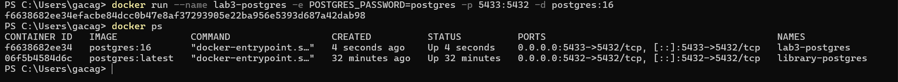

Підключення до PostgreSQL і створення бази даних:

```powershell
docker exec -it lab3-postgres psql -U postgres
```

```sql
CREATE DATABASE library_lab3;
\c library_lab3
```

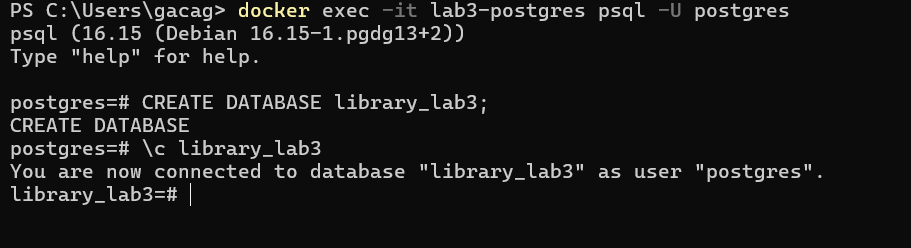

## Виконання роботи

### Рівень 1. Базові операції модифікації

#### Крок 1. Створення структури бази даних

Створено чотири таблиці (`authors`, `books`, `readers`, `lendings`) з обмеженнями цілісності.

**Таблиця авторів:**

```sql
CREATE TABLE authors (
    author_id SERIAL PRIMARY KEY,
    first_name VARCHAR(50) NOT NULL,
    last_name VARCHAR(50) NOT NULL,
    birth_year INTEGER CHECK (birth_year >= 1000 AND birth_year <= EXTRACT(YEAR FROM CURRENT_DATE)),
    country VARCHAR(50),
    created_at TIMESTAMP DEFAULT CURRENT_TIMESTAMP
);
```

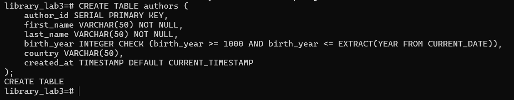

**Таблиця книг:**

```sql
CREATE TABLE books (
    book_id SERIAL PRIMARY KEY,
    isbn VARCHAR(17) UNIQUE NOT NULL,
    title VARCHAR(200) NOT NULL,
    author_id INTEGER NOT NULL,
    publication_year INTEGER CHECK (publication_year >= 1450),
    genre VARCHAR(50),
    total_copies INTEGER DEFAULT 1 CHECK (total_copies >= 0),
    available_copies INTEGER DEFAULT 1 CHECK (available_copies >= 0),
    created_at TIMESTAMP DEFAULT CURRENT_TIMESTAMP,
    FOREIGN KEY (author_id) REFERENCES authors(author_id) ON DELETE RESTRICT,
    CHECK (available_copies <= total_copies)
);
```

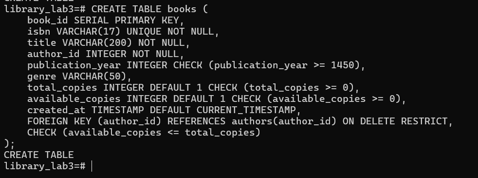

**Таблиця читачів:**

```sql
CREATE TABLE readers (
    reader_id SERIAL PRIMARY KEY,
    first_name VARCHAR(50) NOT NULL,
    last_name VARCHAR(50) NOT NULL,
    email VARCHAR(100) UNIQUE NOT NULL,
    phone VARCHAR(20),
    library_card_number VARCHAR(20) UNIQUE NOT NULL,
    registration_date DATE DEFAULT CURRENT_DATE,
    status VARCHAR(20) DEFAULT 'Active' CHECK (status IN ('Active', 'Blocked', 'Inactive'))
);
```

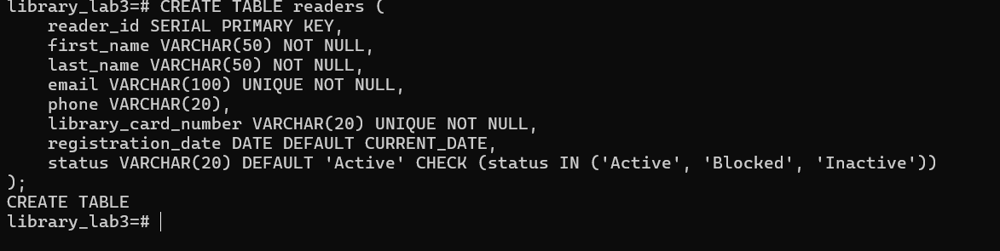

**Таблиця видач:**

```sql
CREATE TABLE lendings (
    lending_id SERIAL PRIMARY KEY,
    book_id INTEGER NOT NULL,
    reader_id INTEGER NOT NULL,
    lending_date DATE DEFAULT CURRENT_DATE,
    due_date DATE NOT NULL,
    return_date DATE,
    FOREIGN KEY (book_id) REFERENCES books(book_id) ON DELETE RESTRICT,
    FOREIGN KEY (reader_id) REFERENCES readers(reader_id) ON DELETE RESTRICT,
    CHECK (due_date > lending_date),
    CHECK (return_date IS NULL OR return_date >= lending_date)
);
```

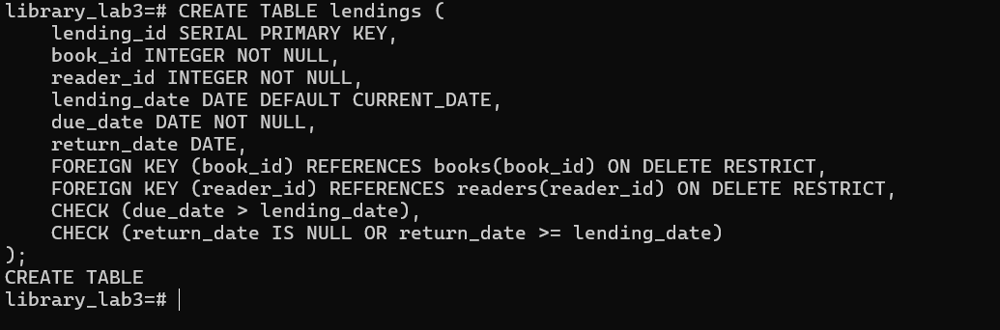

**Перевірка структури:**

```sql
\dt
\d books
```

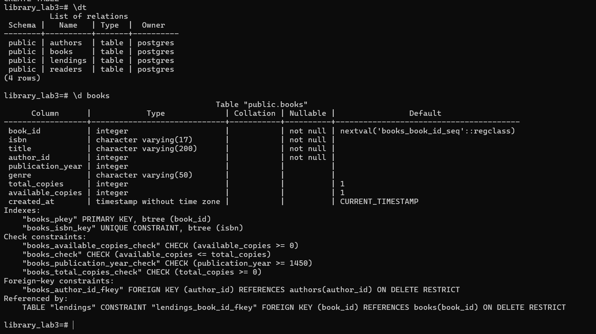

Застосовані обмеження:

- `PRIMARY KEY` (SERIAL) унікально ідентифікує записи в кожній таблиці.
- `NOT NULL` забороняє порожні значення в обов'язкових полях (імена, ISBN, назва, дати).
- `UNIQUE` на `isbn`, `email` та `library_card_number` унікальність цих значень.
- `CHECK` обмежує діапазони значень (роки, кількість примірників, статус читача, `available_copies <= total_copies`, `due_date > lending_date`).
- `FOREIGN KEY ... ON DELETE RESTRICT` забороняє видалення батьківського запису, якщо на нього є посилання.

#### Крок 2. Додавання тестових даних

Додано 5 авторів, 5 книг і 4 читачів.

```sql
INSERT INTO authors (first_name, last_name, birth_year, country)
VALUES
    ('Тарас', 'Шевченко', 1814, 'Україна'),
    ('Іван', 'Франко', 1856, 'Україна'),
    ('Леся', 'Українка', 1871, 'Україна'),
    ('Михайло', 'Коцюбинський', 1864, 'Україна'),
    ('Панас', 'Мирний', 1849, 'Україна');
```

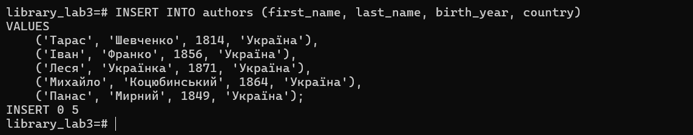

```sql
INSERT INTO books (isbn, title, author_id, publication_year, genre, total_copies, available_copies)
VALUES
    ('978-966-03-4561-2', 'Кобзар', 1, 1840, 'Поезія', 10, 8),
    ('978-966-03-4562-9', 'Захар Беркут', 2, 1883, 'Історична проза', 5, 4),
    ('978-966-03-4563-6', 'Лісова пісня', 3, 1911, 'Драма', 7, 7),
    ('978-966-03-4564-3', 'Тіні забутих предків', 4, 1911, 'Повість', 6, 5),
    ('978-966-03-4565-0', 'Хіба ревуть воли, як ясла повні', 5, 1880, 'Повість', 4, 4);
```

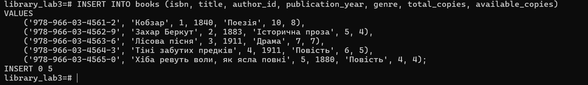

```sql
INSERT INTO readers (first_name, last_name, email, phone, library_card_number)
VALUES
    ('Олена', 'Петренко', 'olena.petrenko@email.com', '+380501234567', 'LIB-2024-001'),
    ('Андрій', 'Коваленко', 'andrii.kovalenko@email.com', '+380502345678', 'LIB-2024-002'),
    ('Марія', 'Сидоренко', 'maria.sydorenko@email.com', '+380503456789', 'LIB-2024-003'),
    ('Іван', 'Мельник', 'ivan.melnyk@email.com', '+380504567890', 'LIB-2024-004');
```

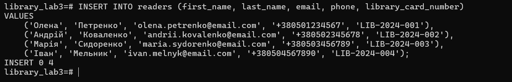

**Перевірка вставлених даних:**

```sql
SELECT * FROM authors;
SELECT book_id, isbn, title, author_id, total_copies, available_copies FROM books;
SELECT reader_id, first_name, last_name, library_card_number, status FROM readers;
```

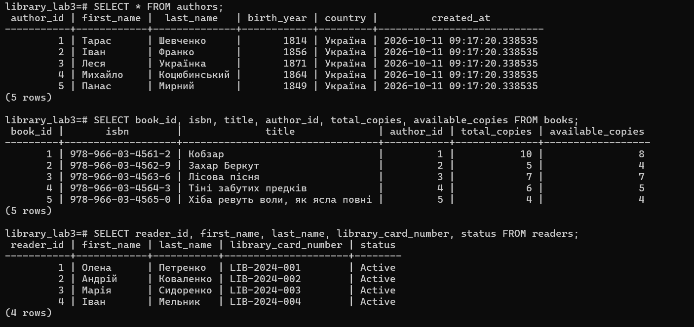

Усі записи додано успішно (`INSERT 0 5`, `INSERT 0 5`, `INSERT 0 4`), а значення за замовчуванням (`status = 'Active'`, `created_at`) заповнилися автоматично.

#### Крок 3. Безпечне оновлення записів

Перед `UPDATE` виконано `SELECT` з тією самою умовою `WHERE`, щоб побачити, який запис буде змінено. У книги «Кобзар» було 8 доступних примірників.

```sql
SELECT book_id, title, available_copies FROM books WHERE book_id = 1;
```

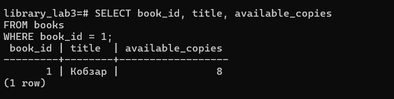

```sql
UPDATE books
SET available_copies = available_copies - 1
WHERE book_id = 1 AND available_copies > 0;
```

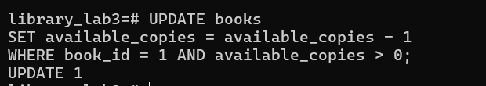

```sql
SELECT book_id, title, available_copies FROM books WHERE book_id = 1;
```

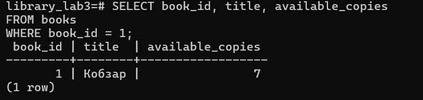

Оновлено рівно один запис (`UPDATE 1`), значення змінилося з 8 на 7. Умова `available_copies > 0` додатково захищає від від'ємної кількості примірників.

#### Крок 4. Операції з транзакціями

Видачу книги реалізовано як одну транзакцію з двох операцій: додавання запису в `lendings` і зменшення `available_copies`.

```sql
BEGIN;

INSERT INTO lendings (book_id, reader_id, due_date)
VALUES (1, 1, CURRENT_DATE + INTERVAL '14 days');

UPDATE books
SET available_copies = available_copies - 1
WHERE book_id = 1 AND available_copies > 0;

SELECT * FROM lendings WHERE lending_id = LASTVAL();
SELECT available_copies FROM books WHERE book_id = 1;

COMMIT;
```

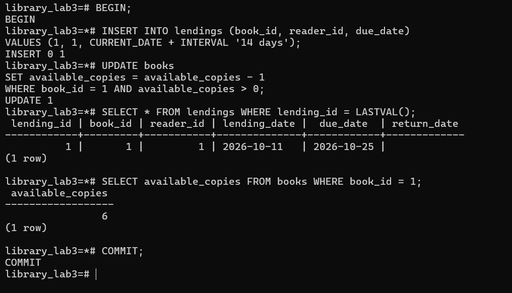

Після `INSERT` і `UPDATE` кількість доступних примірників дорівнює 6. Зміни зафіксовано командою `COMMIT`. Обидві операції виконуються як єдине ціле (атомарність): якщо б одна з них завершилась помилкою, результат другої також був би скасований.

#### Крок 5. Демонстрація ROLLBACK

Спроба видалити автора, у якого є книги:

```sql
BEGIN;
DELETE FROM authors WHERE author_id = 1;
```

Через `ON DELETE RESTRICT` PostgreSQL повернула помилку, і транзакція перейшла в стан aborted (в рядку запрошення з'явився символ `!`). Після цього виконано відкат:

```sql
ROLLBACK;
```

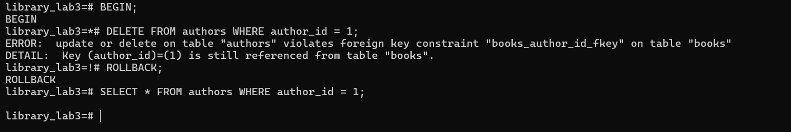

Перевірка, що дані не змінилися:

```sql
SELECT * FROM authors WHERE author_id = 1;
```

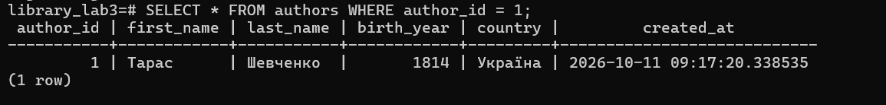

Помилка `violates foreign key constraint "books_author_id_fkey"` підтверджує, що посилальна цілісність працює. `ROLLBACK` повернув базу до стану до початку транзакції, запис про Шевченка залишився.

#### Крок 6. Безпечне видалення

Оскільки неактивних читачів у базі не було, додано тестового читача зі статусом `Inactive`. Потім виконано перевірку (`SELECT`) і видалення з тією самою умовою: видаляються лише неактивні читачі без неповернених книг.

```sql
INSERT INTO readers (first_name, last_name, email, phone, library_card_number, status)
VALUES ('Тест', 'Неактивний', 'test.inactive@email.com', '+380505678901', 'LIB-2024-005', 'Inactive');

SELECT * FROM readers WHERE status = 'Inactive' AND reader_id NOT IN (
    SELECT DISTINCT reader_id FROM lendings WHERE return_date IS NULL
);

DELETE FROM readers
WHERE status = 'Inactive' AND reader_id NOT IN (
    SELECT DISTINCT reader_id FROM lendings WHERE return_date IS NULL
);

SELECT reader_id, first_name, last_name, status FROM readers;
```

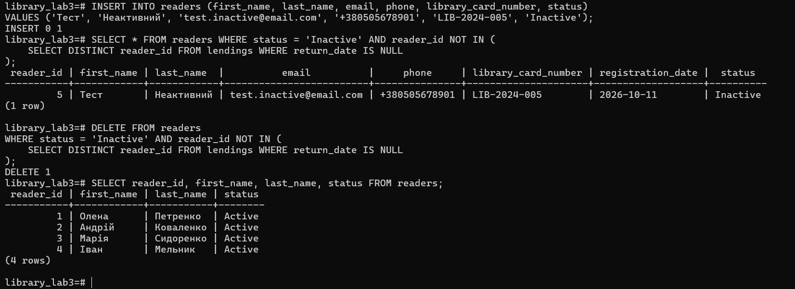

`SELECT` перед видаленням знайшла один запис (тестового читача), `DELETE 1` видалила саме його. В таблиці залишилися 4 активні читачі.

### Рівень 2. Розширена функціональність

#### Крок 1. Додавання нових таблиць

Додано таблиці бронювань (`reservations`) та історії змін (`audit_log`). Зовнішні ключі `reservations` мають `ON DELETE CASCADE`.

```sql
CREATE TABLE reservations (
    reservation_id SERIAL PRIMARY KEY,
    book_id INTEGER NOT NULL,
    reader_id INTEGER NOT NULL,
    reservation_date TIMESTAMP DEFAULT CURRENT_TIMESTAMP,
    expiration_date TIMESTAMP NOT NULL,
    status VARCHAR(20) DEFAULT 'Active' CHECK (status IN ('Active', 'Fulfilled', 'Cancelled', 'Expired')),
    FOREIGN KEY (book_id) REFERENCES books(book_id) ON DELETE CASCADE,
    FOREIGN KEY (reader_id) REFERENCES readers(reader_id) ON DELETE CASCADE
);

CREATE TABLE audit_log (
    log_id SERIAL PRIMARY KEY,
    table_name VARCHAR(50) NOT NULL,
    operation VARCHAR(10) NOT NULL,
    record_id INTEGER NOT NULL,
    old_data JSONB,
    new_data JSONB,
    changed_at TIMESTAMP DEFAULT CURRENT_TIMESTAMP,
    changed_by VARCHAR(100) DEFAULT CURRENT_USER
);
```

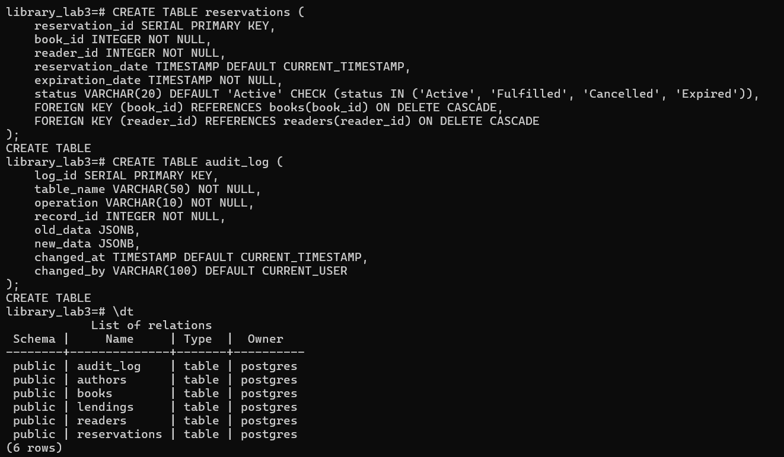

```sql
\dt
\d reservations
```

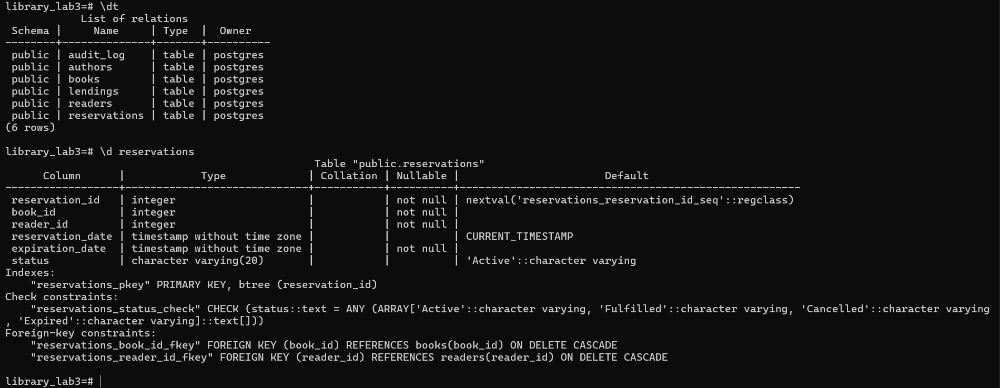

Тепер у базі 6 таблиць. У структурі `reservations` видно зв'язки `ON DELETE CASCADE` з `books` та `readers` і обмеження `CHECK` для статусу.

#### Крок 2. Складні транзакції

Реалізовано повернення книги, яке змінює три таблиці в одній транзакції. Спочатку створено бронювання на «Кобзар» від читача 2 і зафіксовано стан до транзакції.

```sql
INSERT INTO reservations (book_id, reader_id, expiration_date)
VALUES (1, 2, CURRENT_TIMESTAMP + INTERVAL '7 days');

SELECT lending_id, return_date FROM lendings WHERE lending_id = 1;
SELECT book_id, available_copies FROM books WHERE book_id = 1;
SELECT reservation_id, status FROM reservations;
```

Стан до: `return_date` порожня, `available_copies = 6`, бронювання `Active`.

**Транзакція повернення книги:**

```sql
BEGIN;

UPDATE lendings
SET return_date = CURRENT_DATE
WHERE lending_id = 1 AND return_date IS NULL;

UPDATE books
SET available_copies = available_copies + 1
WHERE book_id = (SELECT book_id FROM lendings WHERE lending_id = 1);

SELECT reservation_id, reader_id
FROM reservations
WHERE book_id = (SELECT book_id FROM lendings WHERE lending_id = 1)
    AND status = 'Active'
ORDER BY reservation_date
LIMIT 1;

UPDATE reservations
SET status = 'Fulfilled'
WHERE reservation_id = (
    SELECT reservation_id
    FROM reservations
    WHERE book_id = (SELECT book_id FROM lendings WHERE lending_id = 1)
        AND status = 'Active'
    ORDER BY reservation_date
    LIMIT 1
);

COMMIT;
```

Початок: стан до транзакції, `BEGIN`, оновлення `lendings` і `books`:

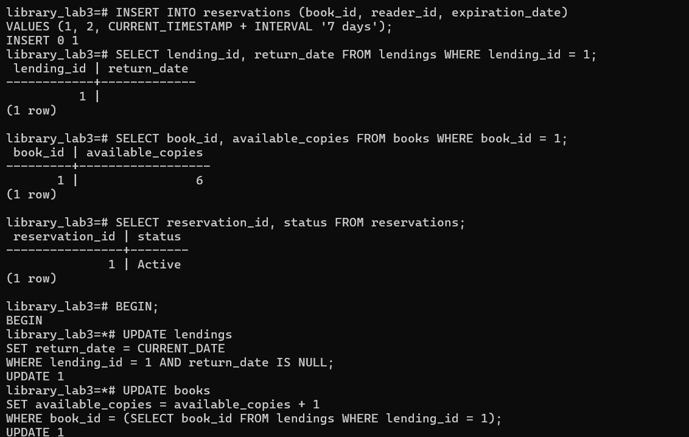

Пошук активного бронювання, оновлення його статусу, `COMMIT` і стан після:

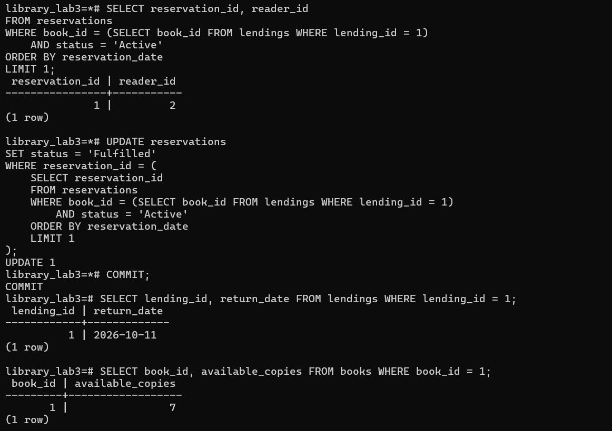

Статус бронювання після транзакції:

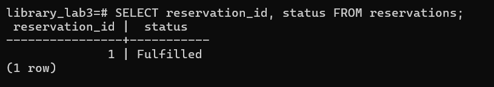

Після `COMMIT`: `return_date = 2026-10-11`, `available_copies = 7`, бронювання має статус `Fulfilled`. Усі три таблиці оновлено атомарно.

#### Крок 3. Використання SAVEPOINT

У транзакції створено дві точки збереження. Навмисна помилка (дублікат ISBN) відкочується до `after_author`, після чого транзакція продовжується. У вставках `LASTVAL()` замінено на явний підзапит `(SELECT author_id FROM authors WHERE last_name = 'Кобилянська')`, оскільки `LASTVAL()` повертає останнє значення будь-якої послідовності сесії, а не обов'язково `author_id`.

```sql
BEGIN;

INSERT INTO authors (first_name, last_name, birth_year, country)
VALUES ('Ольга', 'Кобилянська', 1863, 'Україна');

SAVEPOINT after_author;

INSERT INTO books (isbn, title, author_id, publication_year, genre, total_copies, available_copies)
VALUES ('978-966-03-4566-7', 'Земля', (SELECT author_id FROM authors WHERE last_name = 'Кобилянська'), 1902, 'Роман', 3, 3);

SAVEPOINT after_book;

-- дублікат ISBN: помилка
INSERT INTO books (isbn, title, author_id, publication_year, genre)
VALUES ('978-966-03-4566-7', 'Інша книга', (SELECT author_id FROM authors WHERE last_name = 'Кобилянська'), 1905, 'Роман');

ROLLBACK TO SAVEPOINT after_author;

INSERT INTO books (isbn, title, author_id, publication_year, genre, total_copies, available_copies)
VALUES ('978-966-03-4567-4', 'Земля', (SELECT author_id FROM authors WHERE last_name = 'Кобилянська'), 1902, 'Роман', 3, 3);

COMMIT;
```

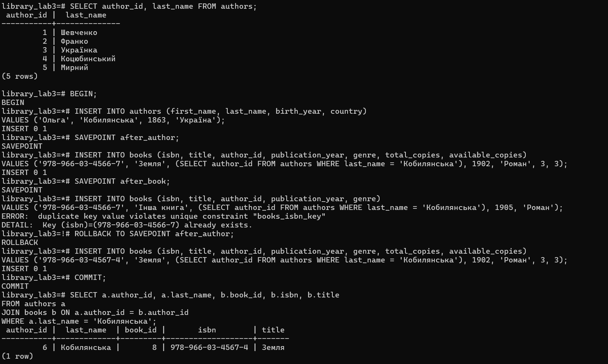

Результат: автор Кобилянська (`author_id = 6`) збережений, а книга «Земля» присутня в єдиному екземплярі з ISBN `978-966-03-4567-4`. Відкат до `after_author` скасував першу вставку «Землі» разом із помилковою, але не торкнувся додавання автора. Значення `book_id = 8` (а не 6) пояснюється тим, що послідовність `SERIAL` не відкочується разом із транзакцією.

#### Крок 4. Каскадні операції

Створено тестового автора, книгу і бронювання на неї, потім видалено книгу. Для вставок також використано явні підзапити замість `LASTVAL()`.

```sql
BEGIN;

INSERT INTO authors (first_name, last_name, birth_year, country)
VALUES ('Тестовий', 'Автор', 1900, 'Україна');

INSERT INTO books (isbn, title, author_id, publication_year, genre, total_copies, available_copies)
VALUES ('978-966-00-0000-0', 'Тестова книга', (SELECT author_id FROM authors WHERE last_name = 'Автор'), 2000, 'Тест', 1, 0);

INSERT INTO reservations (book_id, reader_id, expiration_date)
VALUES ((SELECT book_id FROM books WHERE isbn = '978-966-00-0000-0'), 1, CURRENT_TIMESTAMP + INTERVAL '7 days');

COMMIT;

SELECT b.book_id, b.title, r.reservation_id
FROM books b
LEFT JOIN reservations r ON b.book_id = r.book_id
WHERE b.isbn = '978-966-00-0000-0';

DELETE FROM books WHERE isbn = '978-966-00-0000-0';

SELECT * FROM reservations WHERE book_id NOT IN (SELECT book_id FROM books);

SELECT reservation_id, book_id, reader_id, status FROM reservations;
```

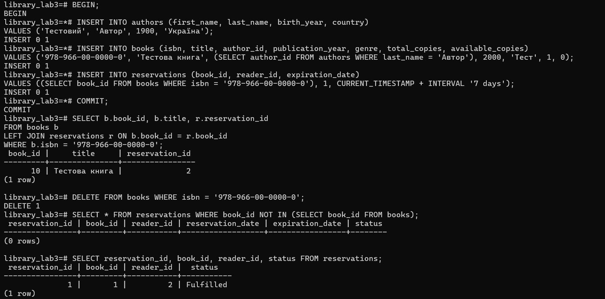

Перед видаленням книга (`book_id = 10`) мала бронювання `reservation_id = 2`. Після `DELETE 1` бронювання видалилося автоматично завдяки `ON DELETE CASCADE`: запит на «осиротілі» записи повернув `(0 rows)`, а в `reservations` залишилося лише бронювання №1 (`Fulfilled`) з попереднього кроку. Для зв'язку `books` → `authors` діє `ON DELETE RESTRICT`, тому автор не може бути видалений, поки в нього є книги.

#### Крок 5. Тригери для аудиту

Створено тригер, який записує кожну зміну таблиці `books` в `audit_log` (старі та нові значення у форматі JSONB, час і користувач).

```sql
CREATE OR REPLACE FUNCTION log_books_changes()
RETURNS TRIGGER AS $$
BEGIN
    IF TG_OP = 'INSERT' THEN
        INSERT INTO audit_log (table_name, operation, record_id, new_data)
        VALUES ('books', 'INSERT', NEW.book_id, row_to_json(NEW)::jsonb);
    ELSIF TG_OP = 'UPDATE' THEN
        INSERT INTO audit_log (table_name, operation, record_id, old_data, new_data)
        VALUES ('books', 'UPDATE', NEW.book_id, row_to_json(OLD)::jsonb, row_to_json(NEW)::jsonb);
    ELSIF TG_OP = 'DELETE' THEN
        INSERT INTO audit_log (table_name, operation, record_id, old_data)
        VALUES ('books', 'DELETE', OLD.book_id, row_to_json(OLD)::jsonb);
    END IF;
    RETURN NULL;
END;
$$ LANGUAGE plpgsql;

CREATE TRIGGER books_audit_trigger
AFTER INSERT OR UPDATE OR DELETE ON books
FOR EACH ROW
EXECUTE FUNCTION log_books_changes();
```

Тестування тригера та перегляд журналу:

```sql
UPDATE books SET available_copies = available_copies + 1 WHERE book_id = 1;

SELECT log_id, operation, record_id,
      new_data->>'title' as title,
      old_data->>'available_copies' as old_copies,
      new_data->>'available_copies' as new_copies,
      changed_at
FROM audit_log
WHERE table_name = 'books'
ORDER BY changed_at DESC;
```

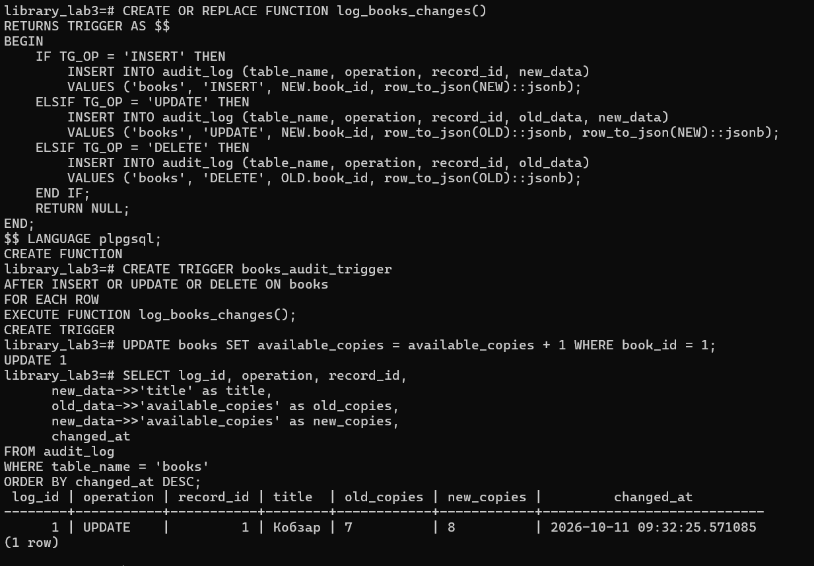

Тригер автоматично зафіксував зміну `available_copies` з 7 на 8 без жодних додаткових дій з боку користувача.

#### Крок 6. Блокування записів

Паралельний доступ продемонстровано двома сесіями psql (дві вкладки PowerShell). Друга сесія підключена командою:

```powershell
docker exec -it lab3-postgres psql -U postgres -d library_lab3
```

**Сесія 1.** Відкрито транзакцію і заблоковано рядок книги (`available_copies = 8`). Транзакцію залишено відкритою:

```sql
BEGIN;
SELECT * FROM books WHERE book_id = 1 FOR UPDATE;
```

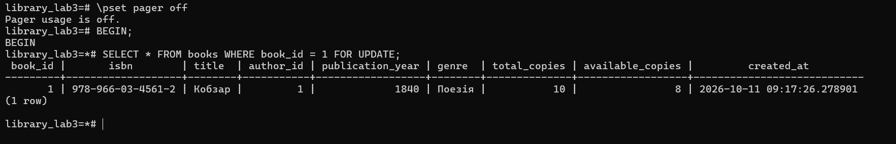

**Сесія 2.** Спроба заблокувати той самий рядок. Запит не повертає результату, а очікує завершення транзакції сесії 1:

```sql
BEGIN;
SELECT * FROM books WHERE book_id = 1 FOR UPDATE;
```

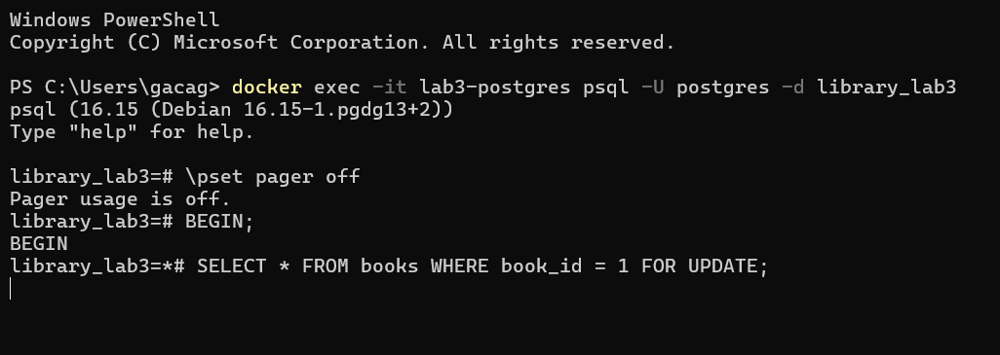

**Сесія 1.** Оновлення і підтвердження транзакції (блокування знімається):

```sql
UPDATE books SET available_copies = available_copies - 1 WHERE book_id = 1;
COMMIT;
```

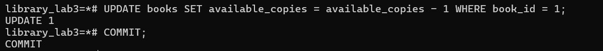

**Сесія 2.** Після `COMMIT` у сесії 1 запит одразу виконався і побачив уже оновлене значення `available_copies = 7`:

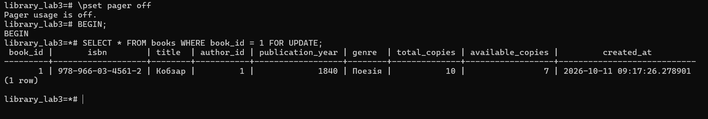

Далі в сесії 2 виконано оновлення та підтвердження:

```sql
UPDATE books SET available_copies = available_copies - 1 WHERE book_id = 1;
COMMIT;
```

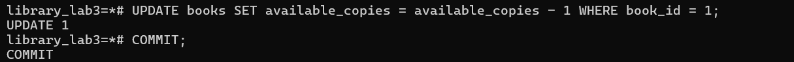

**Перевірка підсумкового стану:**

```sql
SELECT book_id, title, available_copies FROM books WHERE book_id = 1;
```

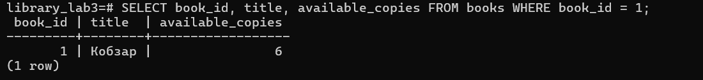

Значення `available_copies = 6` (8 → 7 → 6): обидва зменшення застосовано послідовно. `SELECT ... FOR UPDATE` змусила другу транзакцію чекати, тому вона працювала з актуальним значенням, і втрати оновлень (lost update) не сталося.

## Висновки

У результаті виконання лабораторної роботи здобуто практичні навички безпечної модифікації даних у PostgreSQL.

1. Створено базу даних бібліотеки з обмеженнями цілісності (`PRIMARY KEY`, `FOREIGN KEY`, `UNIQUE`, `CHECK`, `NOT NULL`), які не дозволяють внести некоректні дані.
2. Опановано безпечні операції `INSERT`, `UPDATE`, `DELETE`: перед зміною даних виконувався `SELECT` з тією самою умовою `WHERE`.
3. Вивчено транзакції та властивості ACID. Команди `BEGIN`, `COMMIT`, `ROLLBACK` забезпечують атомарність складних операцій (видача й повернення книги).
4. Використано `SAVEPOINT` для часткового відкату: помилка у вставці не скасовує всю транзакцію.
5. Налаштовано каскадні операції: `ON DELETE CASCADE` автоматично видаляє бронювання при видаленні книги, а `ON DELETE RESTRICT` захищає дані від випадкового видалення.
6. Створено тригер, який автоматично веде історію змін таблиці `books` в `audit_log`.
7. Продемонстровано блокування рядків (`SELECT ... FOR UPDATE`) у двох паралельних сесіях, що запобігає втраті оновлень.

## Посилання на проєкт

Репозиторій: `https://github.com/TuffDasha/db-labs.git`

Склад репозиторію:

```
лаба бази даних/
├── lab01/
│   ├── screens/
│   └── lab01-report.md
├── lab02/
│   ├── screens/
│   └── lab02-repot.md
├── lab03/
│   ├── screenshots/
│   ├── lab03-code.md
│   └── lab03-report.md
├── lab02-report-template.md
└── zvit.repoz.md
```

## Додаток А. Код функції тригера

```sql
CREATE OR REPLACE FUNCTION log_books_changes()
RETURNS TRIGGER AS $$
BEGIN
    IF TG_OP = 'INSERT' THEN
        INSERT INTO audit_log (table_name, operation, record_id, new_data)
        VALUES ('books', 'INSERT', NEW.book_id, row_to_json(NEW)::jsonb);
    ELSIF TG_OP = 'UPDATE' THEN
        INSERT INTO audit_log (table_name, operation, record_id, old_data, new_data)
        VALUES ('books', 'UPDATE', NEW.book_id, row_to_json(OLD)::jsonb, row_to_json(NEW)::jsonb);
    ELSIF TG_OP = 'DELETE' THEN
        INSERT INTO audit_log (table_name, operation, record_id, old_data)
        VALUES ('books', 'DELETE', OLD.book_id, row_to_json(OLD)::jsonb);
    END IF;
    RETURN NULL;
END;
$$ LANGUAGE plpgsql;
```
